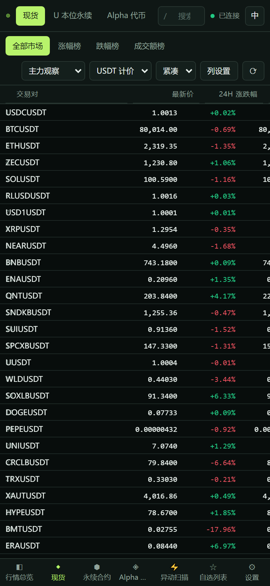

# <div align="center">

# ◎ Crypto Radar

**A professional real-time crypto market terminal for Binance spot, USDⓈ-M perpetuals and Alpha tokens.**

[English](README.md) · [中文](README.zh-CN.md) · [Live demo](https://iiiiiiiiiiiiiKK.github.io/crypto-radar/) · [X](https://x.com/0xkillcoin)

</div>

---

Crypto Radar is a working market monitor, not a mock-up. Every price, volume,
funding rate and candle you see comes from the official public Binance
endpoints, and every screen reacts to a live WebSocket feed.


## What it does

| Module | Highlights |
| --- | --- |
| **Market overview** | One dense table for spot, perpetuals and Alpha tokens. Search, sort on every column, show/hide columns, reorder columns, switch the row density and filter by quote asset. |
| **Live prices** | One shared WebSocket per market (`!miniTicker@arr`) with batched 250 ms updates, price flash animations and an honest connection state. |
| **Candlestick charts** | Lightweight Charts with volume, 15 intervals, historical paging, a live-updating last candle, crosshair OHLC readout and a price line. |
| **Technical indicators** | MA, EMA, RSI and MACD — each toggleable, configurable and rendered on top of the chart without a page reload. |
| **Watchlists** | Multiple named lists, add/remove, rename, reorder, persisted in `localStorage` with corruption-safe reads. |
| **Market screener** | Scans spot, perpetual and Alpha at the same time and renders the anomalies in a virtualised table: strong gainers, strong losers, high volume, elevated funding, short-term moves and a custom rule set. |
| **Bilingual UI** | Complete Chinese and English interfaces driven by one dictionary, with the choice persisted. |

## Screenshots

| Spot | Perpetual futures |
| --- | --- |
|  |  |

| Alpha tokens | Candlestick chart |
| --- | --- |
|  |  |

| Screener | Mobile |
| --- | --- |
|  |  |

## Data sources

All endpoints are public and need **no API key**:

| Market | REST | WebSocket |
| --- | --- | --- |
| Spot | `api.binance.com/api/v3` | `stream.binance.com:9443/ws` |
| Perpetual (USDⓈ-M) | `fapi.binance.com/fapi/v1` | `fstream.binance.com/ws` |
| Alpha tokens | `www.binance.com/bapi/defi/v1/.../alpha/all/token/list` | — (polled every 20 s) |

The Alpha module uses the public token-list endpoint that Binance itself calls
from the Alpha web app; it returns the price, 24 h change, volume, market cap,
liquidity and chain metadata of every Alpha token. **Binance does not publish
a public kline endpoint for Alpha tokens** — instead of inventing candles the
app states this explicitly on the chart page.

Perpetual-only fields (mark price, funding rate, next funding time, open
interest) are read from the dedicated futures endpoints, never from spot data.

## Tech stack

- **React 18** + **TypeScript 5** + **Vite 6**
- **Tailwind CSS 3** with a token-based dark theme
- **Zustand** for state
- **Lightweight Charts 4** (Apache-2.0) for the candlestick chart
- **TanStack Virtual** for the virtualised market table
- **Zod** for response validation
- **Vitest** for unit tests, **Playwright** for end-to-end tests

## Getting started

```bash
git clone https://github.com/iiiiiiiiiiiiiKK/crypto-radar.git
cd crypto-radar
npm install
npm run dev
```

The dev server runs on <http://localhost:5173>.

### Commands

| Command | Description |
| --- | --- |
| `npm run dev` | Start the Vite dev server |
| `npm run build` | Type check and build the production bundle into `dist/` |
| `npm run preview` | Serve the production bundle locally |
| `npm run typecheck` | `tsc -b` without emitting |
| `npm run lint` | ESLint, zero warnings tolerated |
| `npm run test` | Vitest unit test suite |
| `npm run test:e2e` | Playwright end-to-end suite (uses live data) |
| `npm run verify` | typecheck → lint → test → build |

### Environment variables

Everything is optional — the app works out of the box against the official
Binance endpoints. See [`.env.example`](.env.example):

| Variable | Purpose |
| --- | --- |
| `VITE_PROXY_BASE` | Base URL of the bundled edge proxy. Leave empty to call Binance directly. |
| `VITE_SPOT_REST_BASE` / `VITE_FUTURES_REST_BASE` / `VITE_ALPHA_REST_BASE` | Override the upstream hosts. |
| `VITE_SPOT_WS_BASE` / `VITE_FUTURES_WS_BASE` | Override the websocket hosts. |
| `VITE_ALPHA_POLL_MS` | Alpha polling interval in milliseconds (default `20000`). |

## Deployment

### GitHub Pages (this repository)

The `.github/workflows/deploy.yml` workflow builds the app and publishes it to
GitHub Pages on every push to `main`:

1. **Settings → Pages → Build and deployment → Source**: choose **GitHub
   Actions**.
2. Push to `main` — the workflow runs type check, lint, unit tests and the
   production build, then deploys `dist/`.

Live URL: <https://iiiiiiiiiiiiiKK.github.io/crypto-radar/>

Because GitHub Pages has no SPA fallback, the repository ships a `404.html`
that restores deep links such as `/crypto-radar/spot`.

### Edge proxy (optional)

Some networks cannot reach the Binance futures endpoints directly — the exit IP
is rate limited (HTTP 418/429) or the WebSocket upgrade is blocked. The
repository bundles a **Cloudflare Worker** that forwards a fixed, market scoped
set of paths to Binance:

```bash
cd worker
npm install
npx wrangler deploy
```

Then point the front end at it:

```bash
VITE_PROXY_BASE=https://<your-worker>.workers.dev npm run build
```

The proxy is **not** an open relay: the upstream origin and the path prefix
come from a whitelist, unknown routes return `404` and paths outside the
documented Binance API are rejected with `400`.

### Anywhere else

```bash
npm run build
```

`dist/` is a static bundle — it can be hosted on Vercel, Cloudflare Pages,
Netlify or any static host. Set `VITE_BASE_PATH` at build time when the site
is served from a sub-path.

## How the live data works

- **One socket per market.** `WsManager` multiplexes every subscription over
  a single connection, so the app never opens one socket per table row.
- **Batched updates.** Incoming frames are buffered for 250 ms and merged into
  a ticker map, which keeps a busy market from re-rendering the whole table on
  every message.
- **Honest state.** The badge shows *Connecting*, *Live*, *Reconnecting*,
  *Disconnected*, *Delayed* or *Error*. When frames stop arriving for 30
  seconds the feed is marked **stale** instead of pretending the price is live.
- **Backoff with jitter.** Reconnects use exponential backoff plus a random
  jitter and restore every subscription afterwards.
- **Fast first paint.** The 24 h ticker list is fetched first; the heavy
  `exchangeInfo` payload (per-pair tick size, base and quote asset) is merged
  in afterwards and cached for six hours.

## Testing

```bash
npm run test        # 62 unit tests
npm run test:e2e    # 9 Playwright tests x desktop + mobile viewports
npm run verify:live # drives the deployed site against the live API
```

The unit suite covers price/percentage/precision formatting, indicator maths
(MA, EMA, RSI, MACD), API response parsing, screener rules, K-line ordering,
watchlist and settings persistence, the WebSocket subscription/reconnect
logic and the bilingual dictionary.

The end-to-end suite drives a real browser against the **live** Binance API and
checks that rows render, search filters, sorting works, the watchlist survives
a reload, the chart draws candles and indicators, the perpetual table shows
futures-only data (funding rate), the screener filters on real data, the
language toggle switches the interface and that the mobile layout does not
overflow horizontally.

## Security and privacy

- **No API keys, ever.** The project only uses public market data and never
  asks for an exchange key or secret.
- **No trading.** Crypto Radar is a monitoring tool; it cannot place orders.
- **No private data.** Watchlists and preferences stay in your own browser's
  `localStorage`. Nothing is uploaded anywhere.
- **No open proxy.** The optional edge proxy only forwards a fixed, market
  scoped set of paths to Binance — it cannot be used to fetch arbitrary URLs.
- **Validated responses.** Every API payload is parsed with Zod before it
  reaches the UI.
- **Defensive storage.** Corrupted `localStorage` values are discarded
  instead of crashing the app.

## Known limitations

- Binance does not publish Alpha klines, so Alpha tokens have no candlestick
  chart.
- Alpha prices are polled (every 20 s) because Binance exposes no Alpha
  websocket.
- Funding rate, mark price and open interest are only available for perpetual
  contracts.
- In regions where Binance blocks the API, direct calls fail with HTTP 418/429.
  The client rotates through Binance's official hostnames, and the bundled edge
  proxy repeats the rotation from a server-side IP.
- The screener uses the 24 h open price for the short-window calculation
  because Binance does not publish a free short-interval change field for
  every symbol.

## Contributing

See [CONTRIBUTING.md](CONTRIBUTING.md). Architecture notes are in
[docs/ARCHITECTURE.md](docs/ARCHITECTURE.md) and common problems are listed in
[docs/TROUBLESHOOTING.md](docs/TROUBLESHOOTING.md).

## License

[MIT](LICENSE) © Crypto Radar contributors.

Data is provided by the public Binance API; TradingView Lightweight Charts is
licensed under Apache-2.0.

<div align="center">
  <a href="https://x.com/0xkillcoin">
    
  </a>
</div>
