<div align="center">

# ◎ Crypto Radar

**面向 Binance 现货、U 本位永续合约与 Alpha 代币的专业实时行情终端。**

[English](README.md) · [中文](README.zh-CN.md) · [在线演示](https://iiiiiiiiiiiiiKK.github.io/crypto-radar/) · [X](https://x.com/0xkillcoin)

</div>

---

Crypto Radar 是一个真实可用的行情监控工具，不是静态演示。所有价格、成交量、资金费率
和 K 线都来自 Binance 官方公开接口，所有页面都通过 WebSocket 实时刷新。


## 功能清单

| 模块 | 说明 |
| --- | --- |
| **行情总览** | 现货、永续、Alpha 三类市场统一在一张高密度表格中展示。支持搜索、按任意列排序、显示/隐藏列、调整列顺序、切换表格密度、按计价货币筛选。 |
| **实时行情** | 每个市场只建立一条 WebSocket 连接（`!miniTicker@arr`），增量数据按 250 ms 批量合并，价格变化闪烁提示，连接状态如实展示。 |
| **K 线图表** | 基于 Lightweight Charts，含成交量、15 个周期、历史分页加载、最后一根 K 线实时更新、十字光标 OHLC 读数与最新价线。 |
| **技术指标** | MA、EMA、RSI、MACD，可独立开关与配置，切换指标不会触发整页重新加载。 |
| **自选列表** | 支持多个列表，新增/删除/重命名/排序，使用 localStorage 持久化，并对损坏数据做安全降级。 |
| **异动扫描器** | 同时扫描现货、永续与 Alpha 三个市场，用虚拟滚动表格展示异动结果：大幅上涨、大幅下跌、高成交额、资金费率偏高、短时异动以及自定义规则。 |
| **市场热力图** | 按 24 小时成交额加权的矩形树图：面积代表成交额，颜色代表涨跌幅，一眼看出资金在往哪走。 |
| **基差雷达** | 同一币种的现货价与永续价、两者价差，以及把资金费率折算成年的持有成本——现货表或合约表单独都看不出来的跨市场信号。 |
| **价格预警** | 阈值规则实时比对行情，触发时发浏览器通知；本地持久化，可重新启用。 |
| **涨跌家数** | 榜单标签旁的一条堆叠柱，直接显示上涨/下跌家数比例。 |
| **24h 区间条** | 每一行都能看到现价在 24 小时最低—最高之间的位置。 |
| **中英双语** | 统一的国际化字典驱动全部文案，语言选择持久化保存。 |
| **手机端专属设计** | 手机上不是把桌面版缩小：行情改为卡片列表，顶栏拆为两行，市场切换与底部导航独立排布，图表与异动结果同样有专门的手机布局。 |

## 界面截图

| 现货 | 永续合约 |
| --- | --- |
| 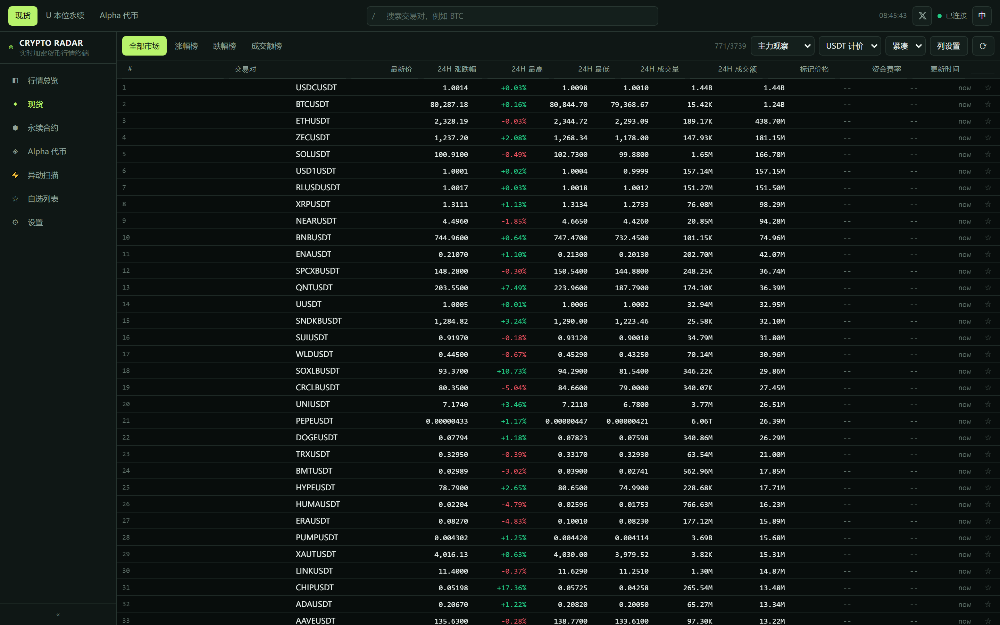 | 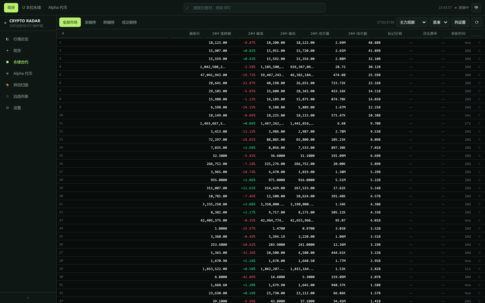 |

| Alpha 代币 | K 线图表 |
| --- | --- |
| 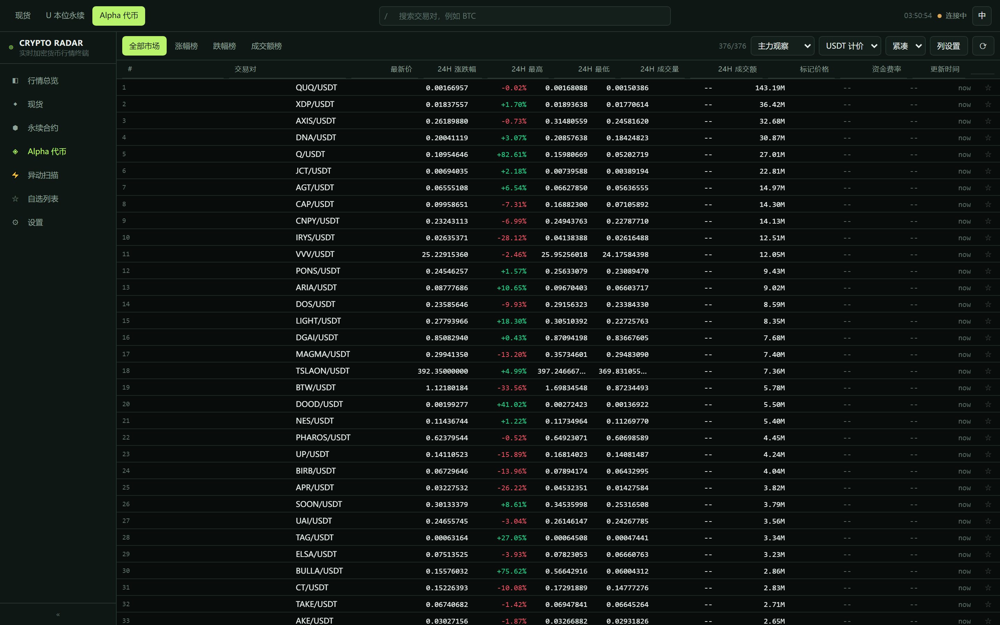 | 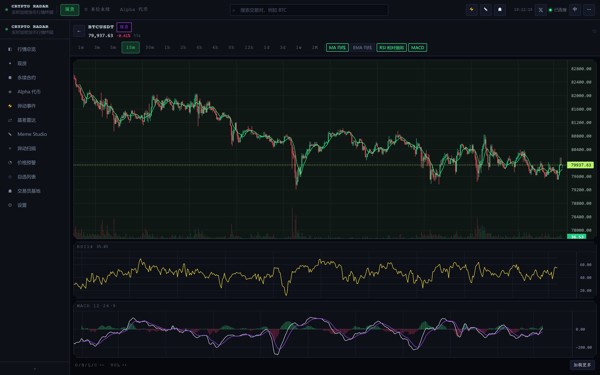 |

| 异动扫描 | 手机端 |
| --- | --- |
| 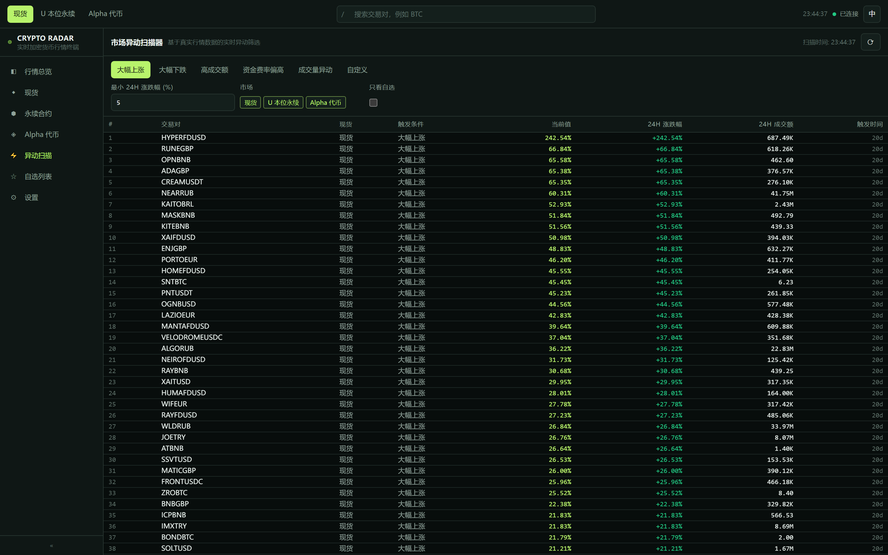 | 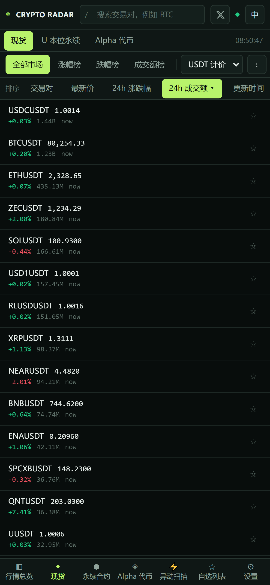 |

| 手机端 — 现货 | 手机端 — K 线 |
| --- | --- |
|  | 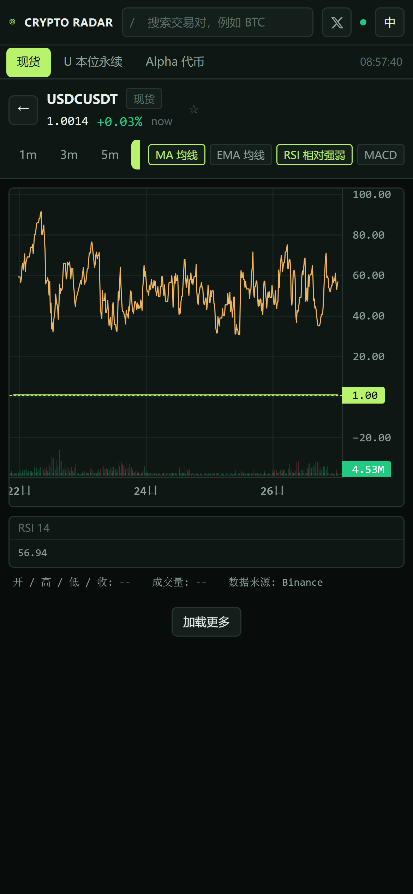 |

| 手机端 — Alpha | 手机端 — 异动扫描 |
| --- | --- |
| 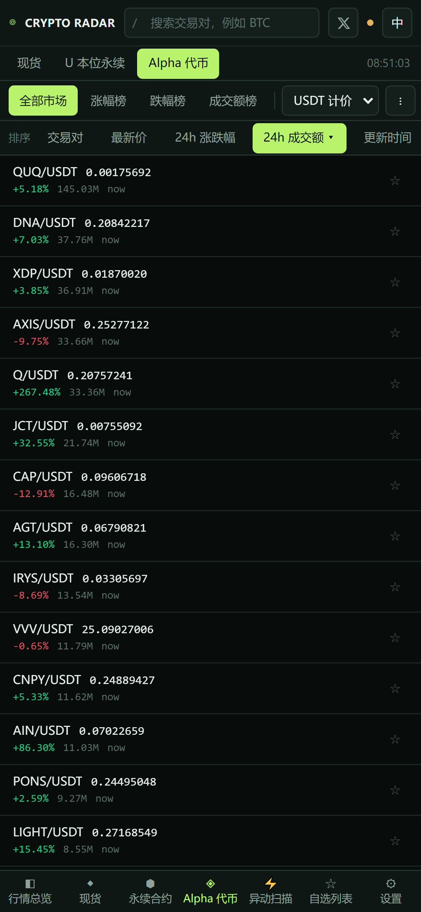 | 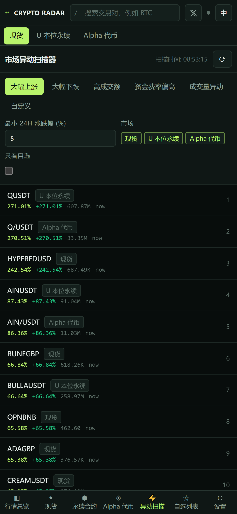 |

## 三个真正拉开差距的功能

| 市场热力图 | 基差雷达 |
| --- | --- |
| 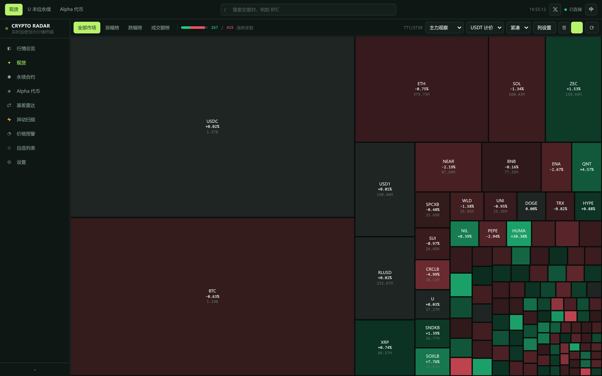 | 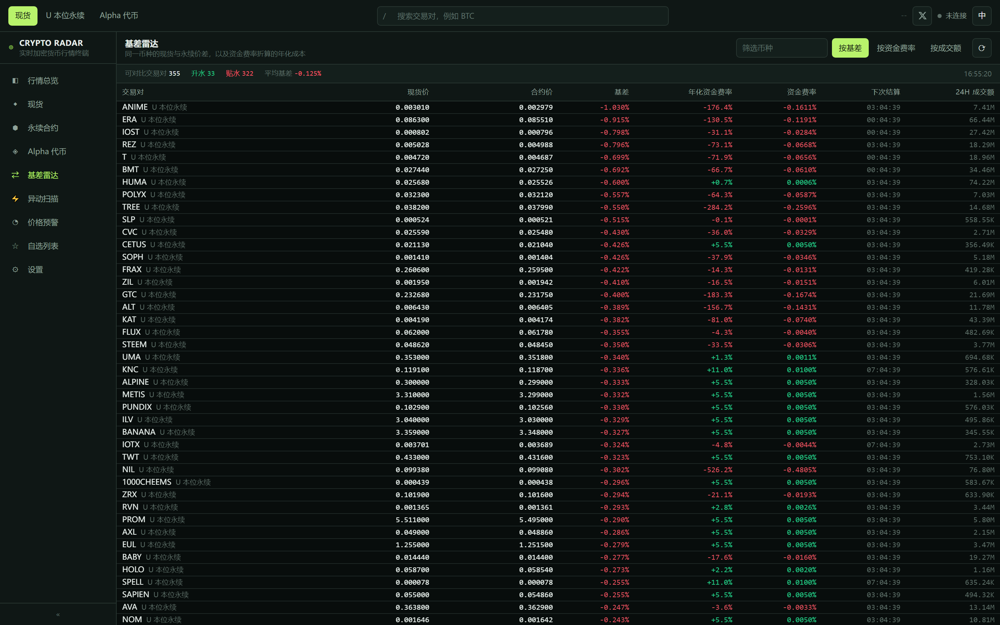 |

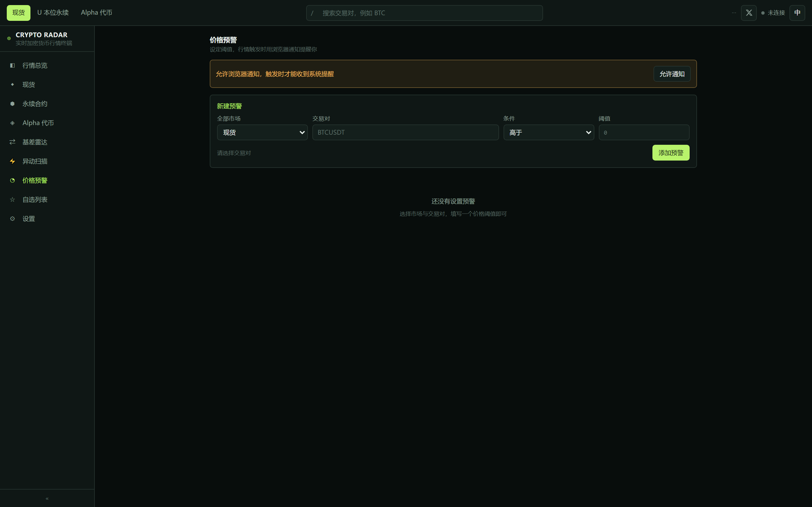

### 一、成交额加权热力图

表格回答「谁在动」，热力图回答**钱在哪里**。每个交易对是一块面积等于 24 小时
成交额、颜色等于 24 小时涨跌幅的矩形，用 squarified treemap 算法排布，保证方块
尽量接近正方形、可读性最好。一键切回列表，排行榜筛选条件继续生效。

### 二、跨市场基差雷达

现货和永续是同一标的的两本账。雷达按基础币种把两边撮合起来，给出合约相对现货的
升贴水，以及把当期资金费率折算成年化（每天三次结算）。升水且资金费率为正，就是
持有多头的资金成本；贴水且资金费率为负，则是反向。这是单市场表格给不出的信号。

### 三、价格预警

对任意现货／永续／Alpha 交易对设置阈值（高于 / 低于）。终端开着时引擎持续比对
实时行情，触发即发浏览器通知，并自动停用该条规则避免刷屏；规则存在
`localStorage`，刷新后依然在。

## 数据来源

全部为公开接口，**不需要任何 API Key**：

| 市场 | REST | WebSocket |
| --- | --- | --- |
| 现货 | `api.binance.com/api/v3` | `stream.binance.com:9443/ws` |
| U 本位永续 | `fapi.binance.com/fapi/v1` | `fstream.binance.com/ws` |
| Alpha 代币 | `www.binance.com/bapi/defi/v1/.../alpha/all/token/list` | —（每 20 秒轮询） |

Alpha 模块使用 Binance Alpha 网页版自身调用的公开代币列表接口，返回每个 Alpha 代币的价格、
24 小时涨跌幅、成交额、市值、流动性和链上元数据。**Binance 并未公开 Alpha 代币的 K 线接口**，
因此图表页面会明确说明该情况，而不会伪造任何 K 线数据。

资金费率、标记价格、下次结算时间、持仓量等永续专属字段，均来自对应的合约接口，
不会用现货数据替代。

## 技术栈

- **React 18** + **TypeScript 5** + **Vite 6**
- **Tailwind CSS 3**，基于设计令牌的深色主题
- **Zustand** 状态管理
- **Lightweight Charts 4**（Apache-2.0）K 线图表
- **TanStack Virtual** 虚拟滚动表格
- **Zod** 接口数据校验
- **Vitest** 单元测试 + **Playwright** 端到端测试

## 本地运行

```bash
git clone https://github.com/iiiiiiiiiiiiiKK/crypto-radar.git
cd crypto-radar
npm install
npm run dev
```

开发服务器地址：<http://localhost:5173>

### 可用命令

| 命令 | 说明 |
| --- | --- |
| `npm run dev` | 启动开发服务器 |
| `npm run build` | 类型检查并构建生产版本到 `dist/` |
| `npm run preview` | 本地预览生产构建 |
| `npm run typecheck` | `tsc -b` 类型检查 |
| `npm run lint` | ESLint 检查，不允许任何警告 |
| `npm run test` | Vitest 单元测试 |
| `npm run test:e2e` | Playwright 端到端测试（使用真实行情） |
| `npm run audit:layout` | 在 5 种设备尺寸上检查每个页面的溢出与截断 |
| `npm run verify:live` | 用真实接口驱动线上站点 |
| `npm run screenshots` | 生成桌面端与手机端截图 |
| `npm run verify` | typecheck → lint → test → build |

### 环境变量

全部为可选项，默认直接访问 Binance 官方接口。详见 [`.env.example`](.env.example)：

| 变量 | 用途 |
| --- | --- |
| `VITE_PROXY_BASE` | 内置边缘代理的地址，留空则直连 Binance。 |
| `VITE_SPOT_REST_BASE` / `VITE_FUTURES_REST_BASE` / `VITE_ALPHA_REST_BASE` | 覆盖上游 REST 域名。 |
| `VITE_SPOT_WS_BASE` / `VITE_FUTURES_WS_BASE` | 覆盖 WebSocket 域名。 |
| `VITE_ALPHA_POLL_MS` | Alpha 轮询间隔（毫秒，默认 `20000`）。 |

## 部署方式

### GitHub Pages（本仓库已配置）

`.github/workflows/deploy.yml` 会在每次推送到 `main` 后自动构建并发布到 GitHub Pages：

1. 进入 **Settings → Pages → Build and deployment → Source**，选择 **GitHub Actions**。
2. 推送到 `main` —— 工作流会依次执行类型检查、静态检查、单元测试和生产构建，然后发布 `dist/`。

在线地址：<https://iiiiiiiiiiiiiKK.github.io/crypto-radar/>

由于 GitHub Pages 没有 SPA 回退机制，仓库内附带 `404.html`，用于恢复 `/crypto-radar/spot`
这类深层链接。

### 边缘代理（可选）

部分网络无法直连 Binance 合约接口：出口 IP 被限流（HTTP 418/429），或 WebSocket 升级被拦截。
仓库内置了一个 **Cloudflare Worker**，把固定的市场相关路径转发到 Binance：

```bash
cd worker
npm install
npx wrangler deploy
```

然后让前端指向它：

```bash
VITE_PROXY_BASE=https://<your-worker>.workers.dev npm run build
```

该代理**不是**开放代理：上游域名与路径前缀均来自白名单，未知路由返回 `404`，
不在 Binance 官方 API 范围内的路径返回 `400`。

### 部署到其他平台

```bash
npm run build
```

`dist/` 是纯静态产物，可直接托管到 Vercel、Cloudflare Pages、Netlify 等平台。
如果部署在子路径下，请在构建时设置 `VITE_BASE_PATH`。

## 实时数据实现

- **每个市场一条连接。** `WsManager` 把所有订阅复用到单条 WebSocket，不会为每个表格行单独开连接。
- **批量更新。** 收到的数据先缓冲 250 ms，再合并进行情映射表，避免高频行情导致整表重渲染。
- **状态如实呈现。** 顶栏显示「连接中 / 已连接 / 重连中 / 已断开 / 数据延迟 / 连接异常」。
  超过 30 秒没有新数据会标记为**数据过期**，不会继续把旧价格伪装成实时行情。
- **指数退避 + 随机抖动。** 断线后按指数退避重连，并恢复全部订阅。
- **首屏更快。** 先请求 24 小时行情列表立即渲染，再在后台合并体量较大的 `exchangeInfo`（含每个交易对的最小价格精度、基础与计价资产），并在本地缓存 6 小时。

## 测试

```bash
npm run test        # 62 项单元测试
npm run test:e2e    # 9 项 Playwright 用例 × 桌面端 + 移动端
npm run verify:live # 用真实接口驱动线上站点
```

单元测试覆盖价格/百分比/精度格式化、指标计算（MA、EMA、RSI、MACD）、接口响应解析、
异动规则、K 线排序、自选列表与设置持久化、WebSocket 订阅与重连逻辑，以及中英文案一致性。

端到端测试使用真实浏览器连接**线上 Binance 接口**，验证行情行渲染、搜索过滤、排序、
自选在刷新后仍然保留、K 线与指标绘制、永续表格展示合约专属数据（资金费率）、
异动扫描基于真实数据筛选、语言切换，
以及移动端不出现横向溢出。

## 安全与隐私

- **永远不需要 API Key。** 只使用公开行情数据，不要求提供交易所密钥。
- **不提供交易功能。** 本项目只是行情监控工具，无法下单。
- **不收集任何隐私数据。** 自选列表与偏好设置仅保存在你自己浏览器的 localStorage 中，不会上传。
- **不是开放代理。** 可选的边缘代理只会转发固定的市场相关路径到 Binance，无法用于请求任意 URL。
- **接口响应全部校验。** 所有 API 数据都经过 Zod 解析后才进入界面。
- **存储容错。** localStorage 中损坏的数据会被丢弃，不会导致应用崩溃。

## 已知限制

- Binance 未提供 Alpha K 线接口，Alpha 代币没有蜡烛图。
- Binance 未提供 Alpha WebSocket，Alpha 数据采用 20 秒轮询。
- 资金费率、标记价格、持仓量仅永续合约可用。
- 在 Binance 限制访问的地区，直连会返回 HTTP 418/429。客户端会自动轮换 Binance 的官方域名，
内置边缘代理则会从服务端 IP 再次轮换。
- 异动扫描的「短时异动」基于 24 小时开盘价计算，因为 Binance 并未为所有交易对提供免费的短周期涨跌字段。

## 参与贡献

详见 [CONTRIBUTING.md](CONTRIBUTING.md)。架构说明见 [docs/ARCHITECTURE.md](docs/ARCHITECTURE.md)，
常见问题见 [docs/TROUBLESHOOTING.md](docs/TROUBLESHOOTING.md)。

## 开源许可证

[MIT](LICENSE) © Crypto Radar contributors。

行情数据由 Binance 公开 API 提供；TradingView Lightweight Charts 采用 Apache-2.0 许可证。

<div align="center">
  <a href="https://x.com/0xkillcoin">
    
  </a>
</div>
